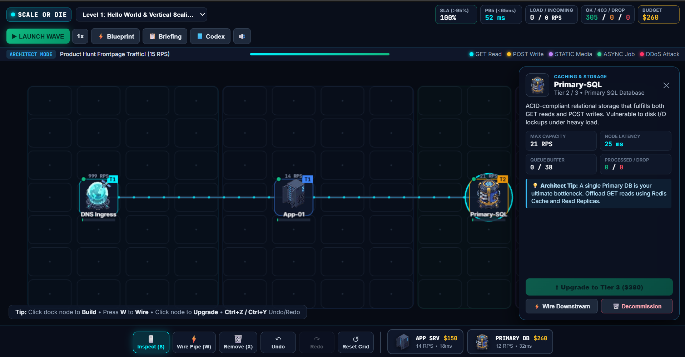
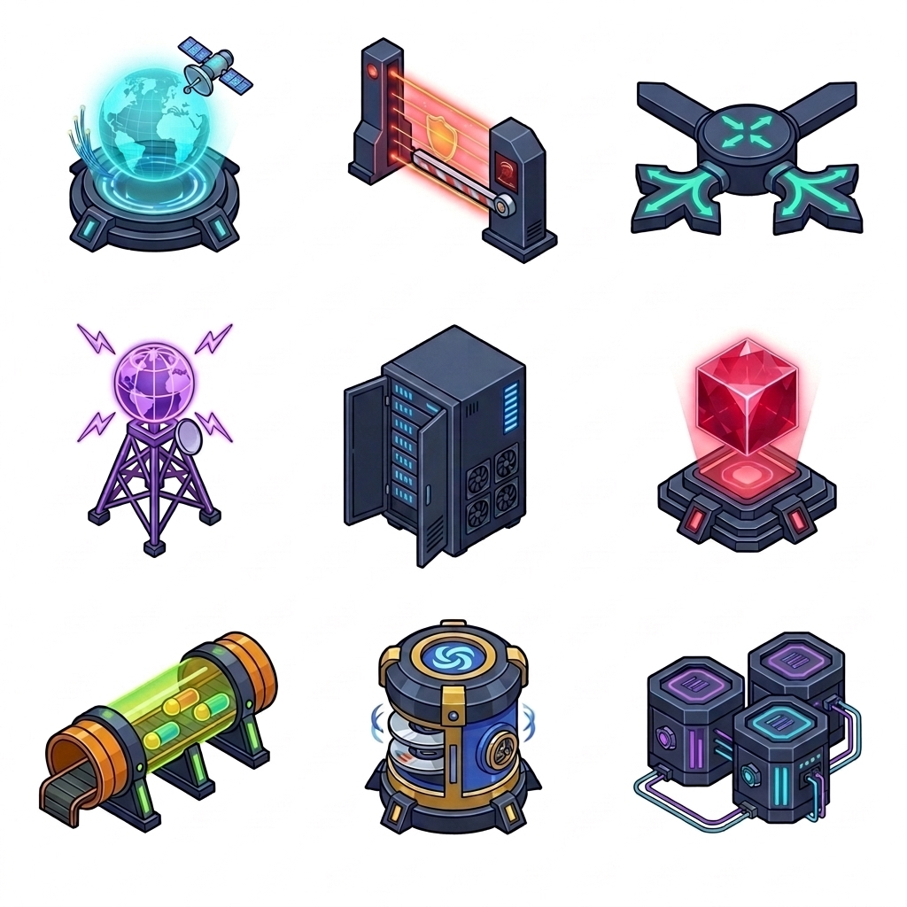
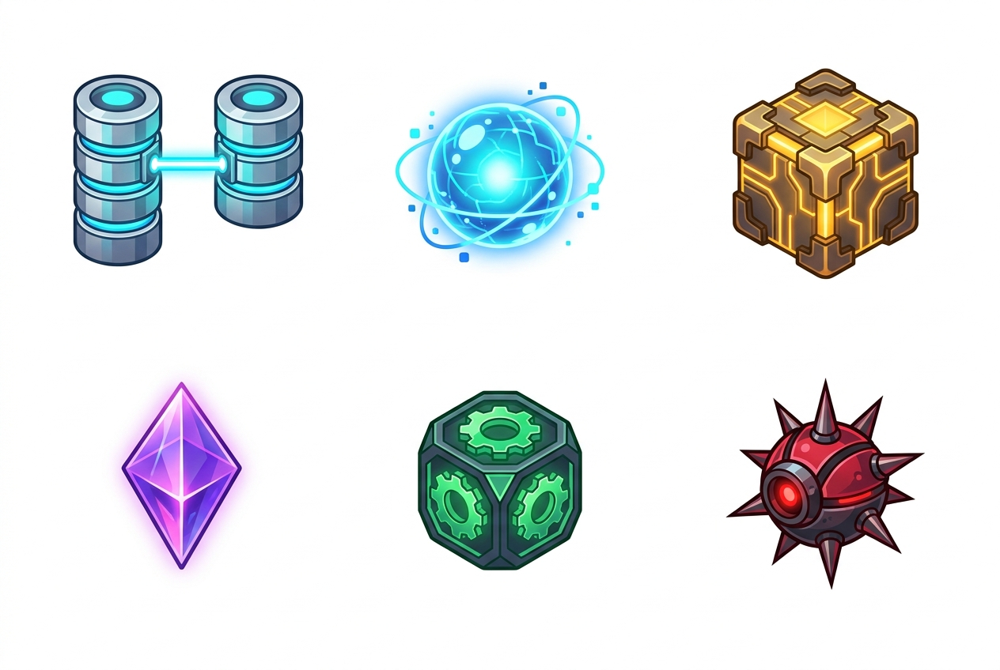

# Scale or Die — The System Design 2D Game ⚡

**Scale or Die** is a 2D Tower Defense & Traffic Routing web game where you play as a Principal Systems Architect defending your cloud infrastructure against escalating waves of real-world traffic (`GET` reads, `POST` writes, `STATIC` 4K media, `ASYNC` background jobs, and `MALICIOUS` DDoS bot floods).

Built with **Phaser 3 (WebGL 60 FPS)** and **Angular 21 (Standalone Components, Signals, `OnPush` Change Detection)**, with custom AI-generated isometric sprites and a zero-dependency procedural Web Audio synthesizer.



---

## 📚 Exported AI Chat, Thinking Log & Architecture Docs

This project was pair-programmed in an interactive session and includes the complete conversation history, internal reasoning (`thinking`), implementation plan, and walkthrough right inside [`docs/`](docs/):

- **[`docs/CHAT_AND_THINKING_LOG.md`](docs/CHAT_AND_THINKING_LOG.md)** — Full step-by-step export of every user prompt, internal chain-of-thought reasoning, tool call, and response from the session.
- **[`docs/IMPLEMENTATION_PLAN.md`](docs/IMPLEMENTATION_PLAN.md)** — The initial technical design document, system design mechanics table, and 7-level campaign plan.
- **[`docs/WALKTHROUGH.md`](docs/WALKTHROUGH.md)** — Verification summary and feature walkthrough.
- **[`docs/transcript.jsonl`](docs/transcript.jsonl)** — Raw machine-readable JSONL session transcript.

---

## 🏗️ System Architecture

```mermaid
flowchart LR
    subgraph Angular["Angular 21 UI Layer (Signals + OnPush)"]
        HUD["Telemetry HUD\n(SLA %, P95 Latency, RPS, Budget, Score)"]
        Linter["Live Architecture Linter\n(Split-Brain DB & Bottleneck Warnings)"]
        Palette["Node Toolbar + Undo/Redo (Ctrl+Z / Ctrl+Y)"]
        Inspector["Contextual Node Inspector & Strategy Tuner"]
        Modal["Briefing, 3-Star Scorecard & System Design Codex"]
    end

    subgraph Bridge["Reactive GameStoreService"]
        Signals["Angular Signals State\n(Budget, SLA, Wave, SelectedNode, History)"]
        EventBus["Typed Scene Commands\n(Place, Wire, Upgrade, Undo/Redo, Auto-Blueprint)"]
    end

    subgraph Phaser["Phaser 3 WebGL Engine (60 FPS)"]
        GridScene["ArchitectureScene\n(Zoned Cyber-Grid, Nodes, Animated Pipes)"]
        RoutingEngine["Pure Routing & Rules Engine\n(Round Robin, Least Conn, Cache Hit/Miss, Sharding)"]
        VFX["WebGL Particle & Floating Text Manager"]
        SFX["Procedural WebAudio Synthesizer"]
    end

    Angular <--> Bridge
    Bridge <--> Phaser
```



---

## 🎮 Custom Isometric Sprites & Traffic Classes

| Infrastructure Nodes (3x3 Sheet) | Read Replica & Traffic Packets (3x2 Sheet) |
| :---: | :---: |
|  |  |

### 10 Cloud Infrastructure Nodes
1. **Internet Ingress (`INGRESS`)**: Public DNS & Fiber entry portal spawning incoming traffic waves.
2. **API Gateway & WAF (`WAF / GW`)**: Inspects L7 traffic and scrubs `MALICIOUS` DDoS bot floods (`403 Forbidden`) before they hit compute or storage.
3. **CDN Edge Network (`CDN EDGE`)**: Terminates `STATIC` media/video requests right at the network edge (`3ms` latency).
4. **L7 Load Balancer (`LOAD BAL`)**: Distributes requests across multiple downstream servers using configurable **Round Robin**, **Least Connections**, or **Consistent IP Hash**.
5. **Stateless App Server (`APP SRV`)**: Executes business logic and smartly routes `GET` reads to Cache/Replicas, `ASYNC` jobs to Kafka, and `POST` writes to Primary DB/Shards.
6. **Kafka Message Queue (`KAFKA MQ`)**: High-capacity asynchronous buffer that absorbs spiky flash-sale bursts (`Load Leveling` & `Backpressure`).
7. **Redis In-Memory Cache (`REDIS`)**: Resolves 84–96% of `GET` reads in RAM (`2ms` latency) via configurable **LRU Cache-Aside**, **Write-Through**, or **Extended TTL** policies.
8. **Primary SQL Database (`PRIMARY DB`)**: ACID-compliant relational storage for reads and writes. *(Placing multiple unsharded Primary SQL DBs triggers a **Split-Brain Anti-Pattern** warning and `409 Conflict` errors!)*
9. **Read Replica DB (`READ REPL`)**: Dedicated read-only SQL replica to offload read-heavy workloads.
10. **Sharded DB Partition (`DB SHARD`)**: Horizontally partitioned database node that scales high-velocity `POST` writes via Consistent Hashing.

---

## 🗺️ The 7-Level Campaign + Chaos Sandbox

1. **Level 1: Hello World & Vertical Scaling** — Wire your first cloud stack and scale hardware tiers vertically (`Tier 1 → Tier 3`).
2. **Level 2: The Slashdot Effect** — Scale stateless compute horizontally behind an **L7 Load Balancer**.
3. **Level 3: Database Meltdown** — Protect SQL disk I/O with an in-memory **Redis Cache**.
4. **Level 4: Viral Media Storm** — Offload 4K video at the **CDN Edge** and split SQL reads using **Read Replicas**.
5. **Level 5: Black Friday Flash Sale** — Buffer spiky `ASYNC` checkout bursts with **Kafka Message Queues**.
6. **Level 6: Write Bottleneck & DB Sharding** — Partition high-velocity writes across a **Sharded Database Cluster**.
7. **Level 7: Botnet Apocalypse (Planet Scale)** — Combine **WAF**, **CDN**, **Load Balancers**, **Redis**, **Kafka**, and **DB Shards** to survive a multi-vector DDoS attack.
8. **Bonus Level 8: Chaos Engineering Sandbox** — Infinite escalating RPS stress test with a `$3,000` cloud budget and all 10 components unlocked.

---

## 🚀 Getting Started

### Prerequisites
- Node.js `v20+` / `v24+` and `npm`

### Installation & Local Development
```bash
npm install
npm start
```
Then open **`http://localhost:4200`** in your browser.

### Keyboard Shortcuts & Controls
- **`B`** or click any node in the bottom dock: **Build Mode**
- **`W`**: **Wire Pipe Mode** (click source node, then click target node to connect data pipes)
- **`S`**: **Inspect Mode** (click any placed node to view live queue telemetry, change routing/caching strategy, or upgrade hardware tiers)
- **`X`**: **Remove Mode** (click a node to decommission for a 75% refund, or click a wire to cut it)
- **`Ctrl+Z` / `Ctrl+Y`**: **Undo / Redo** topology changes
- **`⚡ Blueprint` Button**: Automatically deploys the reference solution for the current level so you can immediately watch the simulation in action.

### Running Unit Tests & Production Build
```bash
npm test -- --watch=false
npm run build
```
