# Scale or Die: The System Design 2D Game — Implementation Plan

## Goal Description
Build **"Scale or Die"**, a 2D Tower Defense & Traffic Routing web game where players act as a Principal Systems Architect defending their cloud infrastructure against escalating waves of real-world traffic. Players place infrastructure nodes on an interactive 2D isometric/pixel-art grid, wire them together with animated data pipes, and survive waves of traffic (`GET` reads, `POST` writes, static media requests, heavy compute payloads, and malicious DDoS floods) while maintaining strict **SLA uptime**, **latency budgets**, and **cloud spend**.

The application combines **Phaser 3 (WebGL)** for a 60+ FPS 2D canvas (sprite animations, packet routing physics, glowing data streams, particle explosions, floating combat text, screen shake) with a modern **Angular** HUD overlay (Signals, Standalone Components, `OnPush` change detection) for the node shop, real-time telemetry charts, architecture briefings, and level progression.

---

## Architecture & Tech Stack

```mermaid
flowchart LR
    subgraph Angular["Angular UI Layer (Signals + OnPush)"]
        HUD["Telemetry HUD\n(Uptime, RPS, P99 Latency, Cloud $$$)"]
        Palette["Node Toolbar & Upgrade Inspector"]
        Modal["Level Briefing & System Design Codex"]
        Score["Wave Complete / SLA Scorecard"]
    end

    subgraph Bridge["Reactive GameStoreService"]
        Signals["Angular Signals State\n(Budget, SLA, Wave, SelectedNode)"]
        EventBus["Typed Event Commands\n(Place, Wire, Upgrade, StartWave)"]
    end

    subgraph Phaser["Phaser 3 WebGL Engine (60 FPS)"]
        GridScene["ArchitectureScene\n(Grid, Nodes, Animated Wires)"]
        PacketSys["Packet Simulation Engine\n(Routing, TTL, Cache Hit/Miss, Sharding)"]
        VFX["WebGL Particle & Shader Manager\n(Sparks, Smoke, Floating Labels)"]
        SFX["Procedural WebAudio Synthesizer\n(Beeps, Sirens, Cache Chimes, Booms)"]
    end

    Angular <--> Bridge
    Bridge <--> Phaser
```

### Core Technical Choices
1. **Phaser 3 (WebGL Renderer)**: Hardware-accelerated 2D rendering, object pooling for hundreds of concurrent traffic packets at 60 FPS, built-in particle emitters for server meltdowns and cache hits, and smooth camera pan/zoom + screen shake.
2. **Angular (Standalone + Signals + OnPush)**: Follows all modern Angular best practices—zero `NgModules`, `changeDetection: ChangeDetectionStrategy.OnPush`, `input()`/`output()`, `computed()` signals, and native `@if`/`@for` templates.
3. **AI-Generated Sprite Assets**: Custom pixel-art/isometric sprites generated via our `image-generator` subagent and processed with transparent backgrounds for every infrastructure component and traffic packet type.
4. **Zero-Dependency Procedural Web Audio Engine**: Synthesizes retro-futuristic sound effects (cache hit chimes, packet pops, server overload alarms, wire connection clicks, DDoS sirens) using the browser's native `AudioContext` so audio works out-of-the-box without external MP3 dependencies.

---

## System Design Mechanics, Nodes & Traffic Types

### 1. Infrastructure Nodes (Towers)
Each node has a **Cloud Cost ($)**, **Capacity (max concurrent RPS)**, **Processing Latency (ms)**, **Queue Size**, and **Upgrade Tiers (Tier 1 → Tier 3)** plus configurable routing strategies:

| Node Type | Role & System Design Mechanic | Configurable Strategies / Upgrades |
| :--- | :--- | :--- |
| **Internet Ingress** | Spawns incoming traffic packets according to the active wave's traffic profile. | Fixed entry point(s) per level. |
| **API Gateway / WAF** | Inspects incoming traffic. Blocks **Malicious / DDoS** packets (`403 Forbidden`) and enforces **Rate Limiting** (`429 Too Many Requests`) before they hit downstream servers. | *Token Bucket Rate Limit*, *DDoS Signature Scrubbing* |
| **Load Balancer (Nginx / ALB)** | Distributes incoming traffic across multiple downstream servers or caches without processing business logic itself. | *Round Robin*, *Least Connections*, *IP Hash* |
| **CDN Edge Node** | Intercepts **Static Asset (`STATIC`)** requests at the edge and serves them immediately with ultra-low latency (`5ms`), offloading 100% of static load from origin. | *Edge TTL Boost*, *Media Compression* |
| **App Server (Stateless Compute)** | Processes business logic. Routes `GET` reads to Cache/DB and `POST` writes to DB or Message Queue. Can horizontally scale by placing multiple instances behind a Load Balancer. | *Horizontal Auto-Scale*, *Worker Threads ( Tier 1–3 )* |
| **Redis Cache** | High-speed in-memory store (`2ms` latency). Intercepts `GET` read packets: on a **Cache Hit (70–90%)**, it immediately resolves the request! On a **Cache Miss**, it forwards the request to the Database. | *TTL Tuning*, *Eviction Policy (LRU / LFU)*, *Write-Through* |
| **Message Queue (Kafka / RabbitMQ)** | Buffers spiky **Async Write / Heavy Job (`ASYNC`)** traffic during viral surges so downstream Worker/DB nodes aren't overwhelmed, smoothing out traffic spikes. | *Partition Count*, *Dead-Letter Queue (DLQ)* |
| **SQL Database (Primary / Monolith)** | Durable storage for `GET` reads and `POST` writes. High latency under heavy load; crashes if concurrent connections exceed max pool size! | *Connection Pooling*, *B-Tree Indexing*, *Vertical Scaling* |
| **Read Replica DB** | Accepts **only `GET` read** traffic. If wired to receive `POST` writes, throws an error unless synced from Primary. Offloads read-heavy workloads. | *Async Replication*, *Read Pool Expansion* |
| **Sharded DB Cluster** | Splits `POST` write and `GET` read load across multiple shards by **Shard Key (`A–M` vs `N–Z` or Hash Modulo)**, overcoming single-primary write bottlenecks. | *Hash Sharding*, *Consistent Hashing (prevents hot-shard skew)* |

### 2. Traffic Packet Types (Enemies)
* **Read Packet (`GET` - Cyan Orb)**: Standard user query. Can be resolved by **Redis Cache** (on hit) or **Primary DB / Read Replica / DB Shard**.
* **Write Packet (`POST` - Amber Cube)**: Mutating data transaction. Must reach a **Primary DB** or **DB Shard** (cannot be fulfilled by Read Replicas or Cache alone).
* **Static Asset Request (`STATIC` - Purple Diamond)**: Heavy images/videos. Best served by a **CDN Edge Node**; clogs App Servers & DBs if routed through origin.
* **Heavy Async Job (`ASYNC` - Green Hex)**: Video transcoding / email batch / analytics event. Takes 5x longer on App Servers unless buffered through a **Message Queue (Kafka)** to dedicated workers.
* **DDoS / Bot Flood (`MALICIOUS` - Crimson Spiked Virus)**: High-velocity junk traffic. Must be scrubbed by a **WAF / API Gateway**; eats up server CPU and crashes databases if let through.

---

## The 7-Level Campaign ("From Garage Startup to Planet Scale")

Each level introduces a real-world failure mode and unlocks the architectural pattern required to conquer it:

1. **Level 1: "Hello World (Single Point of Failure)"**
   * *Scenario*: Launch day for your startup. Wire the `Internet Ingress` → `App Server` → `Primary SQL DB` and vertically upgrade them to survive the first wave.
   * *Concept Taught*: Vertical Scaling & Request/Response lifecycle.
2. **Level 2: "The Slashdot Effect (Horizontal Scaling)"**
   * *Scenario*: A single App Server maxes out its CPU. Unlock the **Load Balancer** and spin up multiple stateless **App Servers** using Round-Robin vs. Least-Connections routing.
   * *Concept Taught*: Horizontal Scaling & Load Balancing algorithms.
3. **Level 3: "Database Meltdown (Caching with Redis)"**
   * *Scenario*: 90% of traffic is repetitive profile reads, and the SQL Database is choking on disk I/O. Unlock **Redis Cache** to absorb 85% of `GET` requests in memory.
   * *Concept Taught*: Cache-Aside pattern, Hit Ratio, and Cache Stampedes.
4. **Level 4: "Viral Media Storm (CDN & Read Replicas)"**
   * *Scenario*: Users are uploading and viewing high-res videos (`STATIC` + heavy `GET` reads). Offload static assets at the edge with a **CDN** and split read/write DB queries using **Read Replicas**.
   * *Concept Taught*: Edge Caching & Read/Write Database Replication.
5. **Level 5: "Flash Sale Spike (Asynchronous Message Queues)"**
   * *Scenario*: Black Friday checkout bursts send massive waves of `ASYNC` order-processing jobs all at once. Use **Kafka / Message Queues** to buffer the spike and drain jobs smoothly at the database's pace.
   * *Concept Taught*: Load Leveling, Backpressure, and Producer-Consumer queues.
6. **Level 6: "Write Bottleneck & Hot Keys (Database Sharding)"**
   * *Scenario*: Write volume (`POST`) exceeds what a single Primary DB can ever handle on one machine. Partition writes across a **Sharded DB Cluster** using Consistent Hashing.
   * *Concept Taught*: Horizontal DB Partitioning (Sharding) & Avoiding Hot Partitions.
7. **Level 7: "Botnet Apocalypse (WAF, Rate Limiting & Planet Scale)"**
   * *Scenario*: A coordinated DDoS attack mixed with legitimate global traffic hits your platform. Combine **API Gateway / WAF**, **CDN**, **Load Balancers**, **Redis**, **Kafka**, and **Sharded DBs** to survive with 99.9% SLA.
   * *Concept Taught*: Defense-in-Depth, Rate Limiting, and Full-Stack Distributed Architecture.
8. **Bonus Mode: "Chaos Sandbox (Infinite RPS Mode)"**
   * Unlimited grid where everything is unlocked, traffic scales exponentially every 30 seconds, and Random Chaos Events (*"US-East-1 Region Outage"*, *"Celebrity Tweet Hot-Shard"*, *"Redis Flush"* ) test your resilience for a high score.

---

## Scoring & SLA Rating (1 to 3 Stars)
At the end of every level, your architecture is graded on three real-world engineering pillars:
1. **Availability (SLA %)**: Percentage of legitimate requests successfully fulfilled before timing out (`99.9%` = Gold, `99.0%` = Silver, `95.0%` = Bronze).
2. **P95 Latency (ms)**: Average round-trip speed of processed packets (rewarding CDN & Redis usage).
3. **Cloud Efficiency ($ Budget)**: Remaining cloud budget vs. over-provisioned idle servers.

---

## Proposed Project Structure (`/home/ahsanayaz/system-design-game`)

### Assets & Sprites
#### [NEW] `public/assets/sprites/`
We will invoke the `image-generator` subagent to generate custom isometric/pixel-art sprites and slice/process them with clean transparency:
* `nodes_sheet.png` / individual node sprites (`ingress.png`, `waf.png`, `load_balancer.png`, `cdn.png`, `app_server.png`, `redis_cache.png`, `message_queue.png`, `sql_db.png`, `read_replica.png`, `db_shard.png`).
* `packets_sheet.png` / packet sprites (`packet_get.png`, `packet_post.png`, `packet_static.png`, `packet_async.png`, `packet_ddos.png`).
* `grid_tile.png` & animated particle textures.

---

### Core Game Engine & Simulation (Phaser 3 + TypeScript)
#### [NEW] `src/app/game/models/game.models.ts`
Strict TypeScript interfaces & branded types (no `any`) for `NodeType`, `PacketType`, `NodeConfig`, `ActiveNode`, `WireConnection`, `PacketEntity`, `LevelDefinition`, `WaveSegment`, and `SlaMetrics`.

#### [NEW] `src/app/game/levels/campaign.levels.ts`
Full definitions for all 7 Campaign Levels + Chaos Sandbox Mode, including starter topologies, pre-placed nodes, wave schedules, system design educational tips, and star thresholds.

#### [NEW] `src/app/game/audio/sound-engine.ts`
Procedural Web Audio API synthesizer generating distinct sound effects for node placement, wire routing, cache hits, DB writes, rate-limit blocks, server overload warnings, and wave victory fanfare.

#### [NEW] `src/app/game/scenes/architecture.scene.ts`
The core Phaser 3 `Scene` running at 60 FPS:
* Interactive isometric/orthographic cyber-grid with hover highlights, placement previews, and animated circuit background.
* Node sprite rendering with live **CPU/Queue load bars**, **status LEDs**, **tier badges**, and **overload smoke/shake animations**.
* Interactive **Wire Drawing Tool** with animated dashed Bézier/orthogonal data pipes showing live throughput direction.
* High-performance **Packet Simulation Loop** handling routing algorithms (Round Robin, Least Connections, Hash Sharding), Cache Hit/Miss rolls, Queue buffering, TTL timeouts, and particle bursts.

---

### Angular UI & State Layer
#### [NEW] `src/app/game/services/game-store.service.ts`
Singleton `@Injectable({ providedIn: 'root' })` service bridging Phaser and Angular using Angular `signal()` and `computed()` state:
* Tracks live RPS, SLA %, P95 latency, Cloud Budget ($), Wave progress, active Level, selected Node inspector details, and simulation speed (`1x`, `2x`, `Pause`).

#### [NEW] `src/app/components/hud-header/hud-header.component.ts`
Top telemetry bar displaying Level Title, Wave Progress, live SLA Uptime gauge, P95 Latency meter, Cloud Budget ($), simulation speed controls (`Start Wave`, `1x/2x`, `Reset`), and Audio mute toggle.

#### [NEW] `src/app/components/node-toolbar/node-toolbar.component.ts`
Bottom/Left dock showing unlocked infrastructure nodes for the current level, their cloud cost, capacity stats, and tool mode toggles (`Build`, `Wire`, `Delete`).

#### [NEW] `src/app/components/node-inspector/node-inspector.component.ts`
Right-hand contextual inspector panel when a placed node is clicked: shows real-time RPS load, queue depth, cache hit rate, routing strategy selector (e.g., *Round Robin* vs. *Least Connections*), and **Upgrade Tier** button.

#### [NEW] `src/app/components/level-modal/level-modal.component.ts`
Interactive System Design Briefing & Victory/Defeat modal explaining the architectural pattern of the level (with visual diagrams/tips), SLA star breakdown, and level selector.

---

## Verification Plan

### Automated Build & Unit Tests
1. Run `npm run build` inside `/home/ahsanayaz/system-design-game` to verify zero TypeScript compilation errors, strict template type-checking, and bundle health.
2. Run unit tests (`npm test -- --watch=false`) validating packet routing logic (Round Robin, Cache Hit/Miss probability, Read Replica write rejection, Sharding modulo distribution, and WAF DDoS filtering).

### Live Visual & Gameplay Verification
1. Start the dev server and inspect the running application to verify:
   * All custom sprites render crisply on the Phaser 3 WebGL canvas at 60 FPS.
   * Placing nodes, drawing wires between nodes, upgrading tiers, and starting waves work seamlessly.
   * Packets visually travel along wires, trigger cache hits on Redis, split across Load Balancers, and update Angular's Signal-driven SLA/Latency HUD in real time.
   * Capture screenshots of the gameplay for the final `walkthrough.md`.
